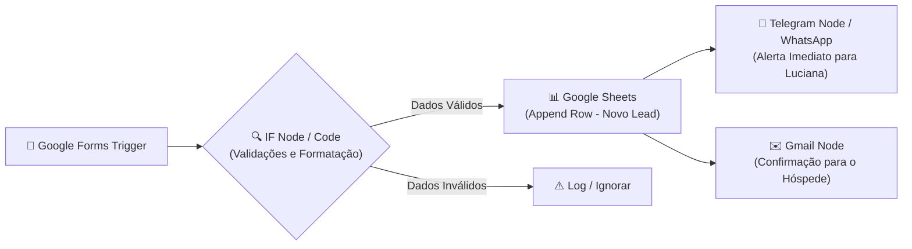

# 🏖️ Automação N8N: Captação e Gestão de Leads para Locação por Temporada (Airbnb)

> **Desafio Criativo DIO:** Planejando Automações com N8N Usando Apenas Bons Prompts  
> **Tema:** Automação de Atendimento e Triagem de Hóspedes para Casa de Veraneio em Peruíbe-SP  
> **Responsável / Anfitriã:** Luciana de Andrade  

---

## 📌 Sobre o Projeto

Este projeto foi desenvolvido como parte do **Desafio Criativo da Digital Innovation One (DIO)**. O objetivo é demonstrar como técnicas de **Engenharia de Prompt** podem ser empregadas para estruturar, planejar e documentar uma automação completa no **N8N** sem escrever código complexo inicialmente, utilizando intenção clara, contexto e regras específicas.

### 🎯 O Case de Negócio
No mercado de locação por temporada (Airbnb e canais diretos), o **tempo de resposta** é decisivo: hóspedes em busca de lazer frequentemente entram em contato com múltiplos anúncios simultaneamente, e a primeira resposta qualificada costuma fechar a estadia.

A anfitriã **Luciana de Andrade** administra uma casa de veraneio em **Peruíbe-SP** e necessita de um fluxo ágil que capture interessados (famílias e grupos para fins de semana e feriados), valide contatos e datas, registre o histórico em planilha e notifique instantaneamente no celular (Telegram/WhatsApp) com link para atendimento rápido.

---

## 🧩 Construção do Desafio Criativo (Passo a Passo)

### 🧱 Passo 1: Defina a automação desejada

```text
Quero criar uma automação no N8N para captar, organizar e qualificar leads interessados na locação por temporada de uma casa de veraneio em Peruíbe-SP (anunciada no Airbnb e canais diretos).

Público ou responsável:
Luciana de Andrade (anfitriã e proprietária do imóvel).

Resultado esperado:
Registrar automaticamente cada interessado em uma planilha/base de dados e enviar um alerta imediato no WhatsApp/Telegram para a Luciana com os dados da reserva (datas, número de hóspedes e contato), permitindo atendimento ágil para fechar a locação e manter alta taxa de ocupação.
```

---

### 🧱 Passo 2: Adicione contexto e regras

```text
Ferramentas envolvidas:
Google Forms, Google Sheets, Telegram Bot (ou WhatsApp API) e Gmail.

Fluxo desejado:
1. Receber uma nova resposta do Google Forms com os dados do interessado (nome, datas de check-in e check-out, número de hóspedes, e-mail e WhatsApp).
2. Validar se os dados obrigatórios e as informações de contato são válidas.
3. Registrar o lead na planilha do Google Sheets com status inicial "Pendente".
4. Enviar uma notificação instantânea para a anfitriã (Luciana) com os detalhes da solicitação e link direto para contato via WhatsApp.
5. Enviar um e-mail de confirmação para o hóspede com as regras da casa e aviso de que a anfitriã responderá em breve.

Regras importantes:
- Ignorar ou segregar respostas sem telefone ou e-mail válidos.
- Formatar o número de telefone no padrão internacional (+55...) para gerar o link de clique direto no WhatsApp.
- Validar se a data de check-out é posterior à de check-in.
```

---

### 🧱 Passo 3: O Prompt Final Consolidado

Este é o prompt final completo, pronto para ser submetido a um modelo de linguagem (LLM) especializado em engenharia de automações:

```text
Atue como um especialista em N8N.

Crie uma automação para captar, organizar e qualificar leads interessados na locação por temporada de uma casa de veraneio em Peruíbe-SP (anunciada no Airbnb e canais diretos).

Público:
Luciana de Andrade (anfitriã e proprietária do imóvel) e potenciais hóspedes (famílias e grupos buscando temporada ou fins de semana).

Ferramentas envolvidas:
Google Forms, Google Sheets, Telegram Bot (ou WhatsApp API) e Gmail.

Fluxo:
1. Receber uma nova resposta do Google Forms com dados da estadia (nome completo, datas de check-in e check-out, quantidade de hóspedes, e-mail e WhatsApp).
2. Validar a consistência dos dados recebidos (campos obrigatórios preenchidos, telefone/e-mail válidos e check-out posterior ao check-in).
3. Registrar os dados na planilha de controle do Google Sheets com status inicial "Pendente".
4. Enviar uma notificação imediata para a anfitriã (Luciana) via Telegram/WhatsApp com os detalhes da solicitação e link direto para iniciar conversa com o hóspede.
5. Disparar um e-mail de confirmação para o hóspede confirmando o recebimento da consulta e apresentando as regras básicas da casa.

Regras:
- Ignorar ou segregar respostas sem telefone ou e-mail válidos.
- Formatar o telefone no padrão internacional (+55...) para viabilizar o link direto do WhatsApp (wa.me/55...).
- Validar se a data de check-out é posterior à de check-in.

Explique quais nós do N8N devem ser utilizados e a lógica de funcionamento do workflow.
```

---

## 🛠️ Arquitetura Técnica Sugerida para o Workflow no N8N

Abaixo está o mapeamento dos nós que atendem à especificação definida pelo prompt:



### Mapeamento dos Nós do N8N:

1. **Google Forms Trigger (ou Webhook):**
   * Dispara a execução a cada nova resposta preenchida pelo potencial hóspede.
2. **Code / IF Node (Validação e Formatação):**
   * Verifica preenchimento de campos obrigatórios (`nome`, `telefone`, `check-in`, `check-out`).
   * Valida se `checkOut > checkIn`.
   * Formata o telefone para o padrão `+55DD9XXXXXXXX` e gera o link `https://wa.me/55...`.
3. **Google Sheets Node (Append Row):**
   * Grava as informações em colunas estruturadas: *Data/Hora, Nome, WhatsApp, E-mail, Check-in, Check-out, Hóspedes, Status ("Pendente")*.
4. **Telegram Node (ou HTTP Request para Evolution API / Z-API):**
   * Dispara mensagem formatada em Markdown para o chat da Luciana com alerta sonoro e botão direto para conversar com o hóspede.
5. **Gmail Node (Send Email):**
   * Envia e-mail de cortesia ao interessado confirmando o recebimento da consulta e informando que a Luciana entrará em contato.

---

## 👨‍💻 Autor e Créditos

Projeto desenvolvido como solução prática de automação e engenharia de prompt para o Desafio Criativo da [Digital Innovation One (DIO)](https://dio.me).
